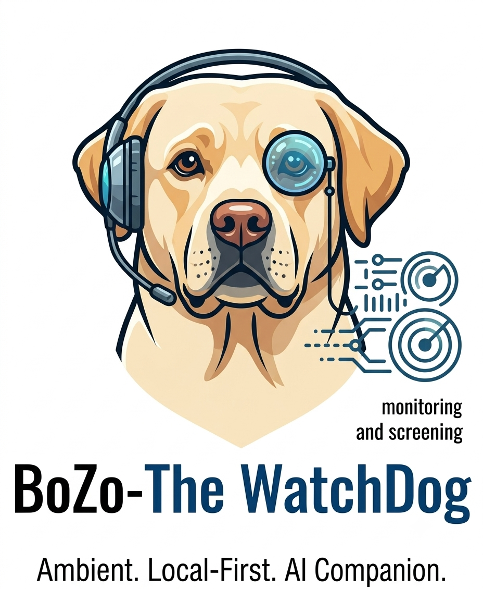
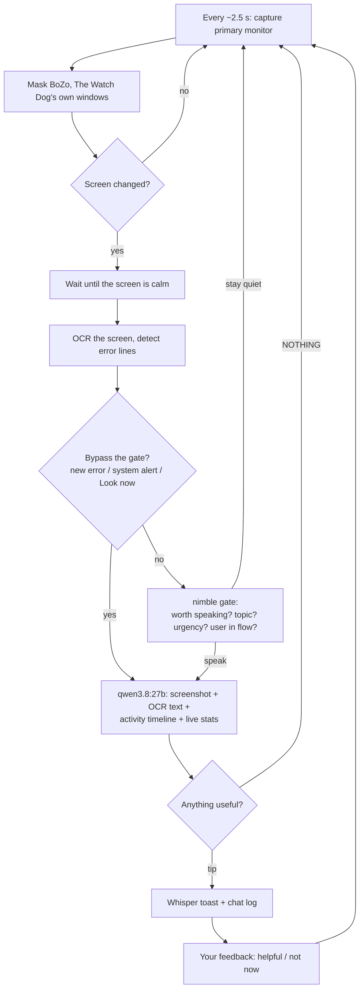

# BoZo, The Watch Dog

<p align="center">
  
</p>

**An ambient, local-first AI companion that watches your screen and whispers help at the right moment.**

BoZo, The Watch Dog runs quietly in your system tray. It reads your screen, tracks your RAM, CPU and VRAM, notices errors as they appear, and offers a short, actionable tip only when it judges that you would welcome one. Everything runs on your own machine through [Ollama](https://ollama.com). No cloud, no API keys, no telemetry.

```
python app.py
```

> **Status:** stable core, active development. It is a small two-file Python app that polls screenshots, so expect edge cases on unusual systems (see [Limitations](#limitations)).

---

## Table of contents

1. [Mission and vision](#mission-and-vision)
2. [The problem it solves](#the-problem-it-solves)
3. [How it works](#how-it-works)
4. [Features](#features)
5. [Requirements](#requirements)
6. [Installation](#installation)
7. [How to use it](#how-to-use-it)
8. [Configuration](#configuration)
9. [Use cases](#use-cases)
10. [Advantages](#advantages)
11. [Limitations](#limitations)
12. [Privacy and security](#privacy-and-security)
13. [Troubleshooting](#troubleshooting)
14. [Roadmap ideas](#roadmap-ideas)
15. [Project structure](#project-structure)

---

## Mission and vision

### Mission

Make AI assistance **proactive instead of reactive**. Today you stop what you are doing, open a chat window, describe your problem, paste an error, and wait. BoZo, The Watch Dog removes that friction: it already sees what you see, so help can arrive without you asking.

### Vision

An **ambient AI layer** on top of your desktop: a companion that understands your context (what you are working on, what just broke, how your machine is coping) and speaks up *sparingly* and *at the right moment*. The goal is the opposite of a noisy assistant. Good timing, brevity and respect for your focus matter as much as being smart.

Guiding principles:

| Principle | What it means in practice |
|---|---|
| **Local first** | Models run through your own Ollama. Screenshots never leave your machine. |
| **Right moment, not every moment** | A fast gate decides whether to interrupt. Staying quiet is a feature. |
| **Short and actionable** | Tips are capped at about 70 words and carry one concrete idea. |
| **You stay in control** | Pause, snooze, give feedback, or quit from the tray at any time. |
| **Honest about limits** | It can be wrong. Treat tips as suggestions, not facts. |

---

## The problem it solves

- **Context switching to ask for help.** Copying errors into a chat window breaks your flow. BoZo, The Watch Dog reads the error where it appears.
- **Errors you stare at too long.** A cryptic stack trace or "CUDA out of memory" gets a likely cause and fix without you leaving the terminal.
- **Invisible resource problems.** RAM pressure, swap thrashing, a full disk or a maxed-out GPU are easy to miss while you work. It watches them continuously and tells you which process or setting is to blame.
- **Local AI is a resource hog.** If you run large models, you need to know your VRAM headroom. The status bar shows RAM and VRAM live, and the assistant sees which Ollama models are loaded and how much of each sits in GPU memory.
- **Generic assistants lack context.** A normal chatbot knows nothing about what is on your screen right now. Here, every answer can use the current screenshot, on-screen text, recent activity and live system stats.

---

## How it works

BoZo, The Watch Dog uses three components, each doing the job it is best at:

| Component | Role | Why this one |
|---|---|---|
| **OCR** (RapidOCR, or Tesseract as fallback) | Reads text on screen and finds error-looking lines | Gives the text-only gate model "eyes" |
| **`nimble`** (9B decision model, via Ollama's `/v1/systemone`) | Fast gatekeeper: *"Is now a good moment to speak? About what? How urgent? Is the user in flow?"* | It scores answers directly with no reasoning step, so it is quick and cheap to run often |
| **`qwen3.8:27b`** (vision + reasoning, via Ollama `/api/chat`) | Looks at the screenshot plus context and writes the whisper | Multimodal, so it can understand what is actually on screen |

> `nimble` is a classifier. It cannot see images or write prose. That is why OCR feeds it text and why `qwen3.8:27b` writes the tips.

### The pipeline



### Step by step

1. **Capture.** The primary monitor is captured about every 2.5 seconds. A tiny 64x36 grayscale copy is compared with the previous frame to measure how much changed.
2. **Self-masking.** BoZo, The Watch Dog's own chat window and toast are blacked out in each frame, so it never reads (and reacts to) its own tips.
3. **Settle.** It does not interrupt while the screen is changing quickly (scrolling, typing, video). It waits for about two calm ticks before looking.
4. **Read.** OCR extracts the screen text. A set of patterns flags error-like lines (tracebacks, `*Error:` / `*Exception:`, "out of memory", "permission denied", `npm ERR!`, "build failed", HTTP 4xx/5xx and so on).
5. **Gate.** Unless something is urgent, `nimble` receives a compact text snapshot (active window, recent activity, error lines, an OCR excerpt, system alerts, recent tips, your feedback history) and answers four questions:
   - `worth_speaking` (probability)
   - `user_in_flow` (probability)
   - `topic` (explain, compose, agent, research, resources, workflow, or nothing)
   - `urgency` (can wait, soon, now)
6. **Decide.** It speaks only if `worth_speaking` clears the threshold, the user is not in flow (unless urgency is high), the topic has not been repeatedly waved off, and the cooldown has passed.
7. **Whisper.** `qwen3.8:27b` receives the screenshot, OCR text, activity timeline and live stats (including top memory processes and Ollama's loaded models). It replies with one short tip, or exactly `NOTHING`.
8. **Learn.** Your **helpful** / **not now** clicks adjust how often a topic is allowed to interrupt you.

### What bypasses the gate

These skip `nimble` because they deserve attention, though `qwen3.8:27b` can still decide there is nothing useful to add:

- a **new** error line on screen (already-handled errors are de-duplicated, even if timestamps change)
- a **new** system alert (RAM, swap, disk, CPU, VRAM or GPU temperature over its threshold)
- you pressing **Look now**

---

## Features

- **Live resource bar:** RAM, CPU, VRAM and GPU utilization, updated every second.
- **Whisper toasts:** small auto-fading notes above the chat window, colored by topic, with hover-to-keep.
- **Chat window:** docked bottom-left, always on top. Ask anything; answers can use the current screenshot and live stats.
- **System tray:** show/hide chat, pause/resume, Look now, snooze 30 minutes, quit. The icon color shows state (watching, thinking, paused, snoozed).
- **Vision-model selector:** pick any installed Ollama model (top-right) for whispers and chat; the choice persists across restarts, and **Refresh models** (tray or `/models` in chat) re-reads Ollama after an `ollama pull`.
- **Pre-publish check:** a window that scores a pasted draft (tweet/email/DM) on six dimensions — toxicity, tone, inclusivity, accidental-exposure, misread-risk and virality — using the local `nimble` classifier, returning a `Ship it` / `Rethink it` / `Hard no` reading.
- **Proactive offers:** when you pause mid-composition or inside an AI agent, BoZo can offer a drafted continuation or a sharper prompt, each with a **COPY** button to paste it back.
- **OCR-driven error detection** with de-duplication so you are not told about the same error twice.
- **Context memory:** a timeline of the windows you have used and for how long (the last few plus the current one) is part of every analysis.
- **Flow-aware timing:** screen-calm detection plus `nimble`'s `user_in_flow` score to avoid interrupting focused work.
- **Local, deletable memory:** every tip, error, chat turn and verdict you keep is stored in SQLite on your machine, recalled by signature + keyword match (no embeddings, no new model), and steers future answers. Browse it, delete what you want, prune to retention, or export it all from the **Memory** window.
- **Feedback loop:** repeated "not now" on a topic suppresses it unless it becomes urgent.
- **Snooze that still protects you:** while snoozed, critical system alerts still come through.
- **GPU monitoring with fallback:** reads NVIDIA stats through `pynvml`, and falls back to `nvidia-smi` if that is unavailable. If both fail, the chat tells you exactly why.
- **Graceful degradation:** if `nimble` is unavailable the gate is skipped and triggers fall back to screen-change and alert logic. No OCR engine means no error-line detection, but the vision model can still read the screenshot.

---

## Requirements

**Hardware.** The default models are large:

| Model | Approx. size |
|---|---|
| `qwen3.8:27b` (default Q4_K_M build, includes vision encoder) | about 18 GB |
| `nimble` | about 9.3 to 9.5 GB |

Running both comfortably wants roughly **27 GB or more of GPU memory**, for example an RTX 5090 (32 GB). On smaller GPUs, parts spill into system RAM and get slower. You can switch `VISION_MODEL` to a smaller or more heavily quantized build.

**Software**

- Python 3.9+ with `tkinter` (included with the python.org and Anaconda installers; on Debian/Ubuntu: `sudo apt install python3-tk`)
- [Ollama](https://ollama.com/download) **0.35 or newer** (required for `nimble`'s decision endpoint)
- Windows is the most-exercised platform. macOS and Linux are supported on a best-effort basis (see [Limitations](#limitations)).

**Python packages** (see `requirements.txt`): `requests`, `psutil`, `mss`, `Pillow`, `numpy`, `rapidocr-onnxruntime`, `pystray`, `nvidia-ml-py` (the last is optional).

---

## Installation

```bash
# 1. Get the models
ollama pull nimble
ollama pull qwen3.8:27b

# 2. (Recommended) create an environment
conda create -n aispace python=3.11 -y
conda activate aispace

# 3. Install dependencies into THAT interpreter
python -m pip install -r requirements.txt

# 4. Run
python app.py
```

> Always use `python -m pip`, not bare `pip`. It guarantees packages land in the same interpreter that runs the app. A mismatch is the most common cause of "OCR says tesseract" or "VRAM n/a".

**Optional**

- **Tesseract** (`pytesseract` plus the Tesseract binary) works as an OCR fallback if you do not want RapidOCR.
- **Linux window titles** need `xdotool` (X11 only).

### Check that it started correctly

The chat window should show lines like:

```
Ready. Gate: nimble, vision: qwen3.8:27b. I'll whisper when I spot something useful...
OCR: rapidocr
GPU: NVIDIA GeForce RTX 5090 (32 GB) via pynvml
```

If a line is missing or shows a warning, see [Troubleshooting](#troubleshooting).

---

## How to use it

### The window

- **Top bar:** live RAM, CPU and VRAM, plus the current state (`watching`, `paused` or `snoozed`).
- **Log:** a history of whispers, your messages and system notes.
- **Input box:** type a question and press Enter. If watching is on, the latest screenshot and live stats are attached automatically.
- **Pause / Resume:** stops all automatic screen capture. Nothing is captured by the monitor while paused; **Look now** still works as a manual override so you can test what a tip would say.
- **Look now:** forces an immediate analysis, skipping the gate and cooldowns. It tells you if there is nothing notable.

### The whispers

When BoZo, The Watch Dog has something to say, a toast fades in above the chat window:

- the **colored stripe and label** show the topic (explain, compose, agent, resources, research or workflow)
- a **COPY** button (on drafts, bug explanations and prompt offers) copies it to your clipboard
- **helpful** and **not now** teach it what you want more or less of
- **dismiss** closes it; hovering keeps it visible a little longer

Closing the window with the **X** hides it to the tray (if the tray icon is available). Use the tray menu to bring it back or to quit.

### The tray menu

| Item | What it does |
|---|---|
| Show / hide chat | Toggles the window (also the default click action) |
| Pause / Resume watching | Stops or restarts capture |
| Look now | Immediate analysis |
| Pre-publish check | Open the draft-check window (see [Features](#features)) |
| Refresh models | Re-read Ollama's model list after an `ollama pull` |
| Snooze 30 min | Silences whispers for 30 minutes. Critical RAM/VRAM/disk/CPU/temperature alerts still appear |
| Quit | Exits the app |

### The Memory window

Open it with the **Memory** button in the toolbar. It is BoZo's local memory — a
SQLite database on your machine, readable, deletable, and exportable.

- **The list** shows the most recent rows (newest first), colored by kind:
  orange (errors), green (tips), blue (your chat), teal (BoZo's chat), brown
  (notes). Double-click any row to read the full text and its context.
- **Filter** narrows to one kind (drop the "All" dropdown for a live count).
- **Delete selected** removes the rows you highlighted (Ctrl/Shift-click for
  multiple). A confirm dialog shows exactly how many.
- **Prune to retention** applies the built-in schedule — errors and tips kept
  90 days, chat 30 days, notes 30 days — and deletes anything older.
- **Export as JSON** writes the entire store to a file you choose (and opens it),
  so you can archive, back up, or diff it.
- **Delete all** requires you to type `yes`. There is no undo.
- The **stat line** reports row counts, per-kind totals, the on-disk size,
  whether full-text search is active, and the store's path.

Nothing in Memory is sent anywhere. It is the raw input BoZo re-reads when a
familiar error reappears ("did the last fix work?") and in chat context.

### Example interactions

| You are doing this... | BoZo, The Watch Dog might whisper... |
|---|---|
| A Python training run crashes with `CUDA out of memory` | A likely cause (batch size, another process holding VRAM) and the first thing to try |
| Your RAM sits above 90% and swap is climbing | Which process is the biggest consumer and what to close or tune |
| You ask in chat: *"why is my 5090 at 95% VRAM?"* | A breakdown using the loaded Ollama models, their GPU share and the top processes |
| You keep a long stack trace on screen without typing | A short plain-English reading of the exception and where to look |

---

## Configuration

All settings are constants at the top of `app.py`.

| Setting | Default | Meaning |
|---|---|---|
| `OLLAMA_HOST` | `http://localhost:11434` | Where Ollama is running |
| `GATE_MODEL` | `nimble` | Decision model for the gate |
| `VISION_MODEL` | `qwen3.8:27b` | Vision + reasoning model. Change this to run a smaller model |
| `TICK_SECONDS` | `2.5` | Capture loop interval |
| `SETTLE_TICKS` | `2` | Calm ticks required before analyzing |
| `MIN_ANALYSIS_GAP` | `8` s | Minimum time between analyses |
| `MIN_TIP_GAP` | `12` s | Minimum time between unprompted whispers |
| `SCREEN_CHANGE_PCT` | `3.0` | Mean pixel change (0 to 100) that counts as a change |
| `GATE_THRESHOLD` | `0.48` | Minimum `worth_speaking` probability to proceed |
| `FLOW_BLOCK` | `0.70` | `user_in_flow` probability above which it stays quiet |
| `OCR_MAX_CHARS` | `1800` | OCR text sent to the vision model |
| `TOAST_SECONDS` | `20` | Base display time for a whisper |
| `DWELL_SECONDS` / `DWELL_GAP` | `30` s / `40` s | Screen-static trigger for a proactive look, and minimum gap between such triggers |
| `DWELL_COMPOSE` / `DWELL_AGENT` | `12` s / `15` s | Static time that makes BoZo offer a draft (compose) or a better prompt (agent) |
| `RAM_WARN` / `SWAP_WARN` / `VRAM_WARN` / `DISK_WARN` / `CPU_WARN` | `90` / `60` / `92` / `95` / `95` (%) | Alert thresholds. GPU temperature alerts trigger at 85 C |

**Tuning tips**

- Too chatty: raise `GATE_THRESHOLD`, `MIN_TIP_GAP` and `SETTLE_TICKS`.
- Too quiet: lower `GATE_THRESHOLD`, or use **Look now** to test what it would say.
- Slow machine: raise `TICK_SECONDS` and `MIN_ANALYSIS_GAP`.

The behavior prompts (`WHISPER_PROMPT`, `CHAT_PROMPT`) and the error patterns (`ERROR_PATTERNS`) are also plain constants you can edit.

---

## Use cases

**Developers**
- Get a likely cause and fix for tracebacks, failed builds and `npm ERR!` output without copy-pasting.
- Catch "out of memory" situations on local ML training runs and see what is holding VRAM.
- Get a nudge when a dev server, container or runaway process is eating RAM.

**Local-LLM and ML practitioners**
- Track VRAM headroom while juggling multiple Ollama models.
- Understand how much of each loaded model sits in GPU memory versus system RAM.
- Spot thermal throttling risk (GPU temperature alerts).

**Researchers and students**
- While reading papers or docs, ask the chat about what is on screen (it can see it).
- Get research pointers related to what you are working on.

**Everyday power users**
- Keep an eye on disk space, swap and CPU saturation.
- Use it as a screen-aware helper for confusing dialogs and error messages.

**Tinkerers**
- A compact, readable reference for building screen-aware local agents: capture, OCR, gating, vision model, tray, toasts.

---

## Advantages

- **Private by design.** Local models, local OCR, no network calls except to your own Ollama.
- **Context-aware.** It combines pixels, on-screen text, recent activity and hardware stats, which a plain chatbot lacks.
- **Cheap to be watchful.** The fast `nimble` gate means the 27B model only wakes up when it is likely worth it.
- **Respectful of focus.** Screen-calm detection, flow scoring, cooldowns, snooze and feedback all work to reduce interruptions.
- **Hardware-aware.** Treats your own machine's health as part of "what you are doing", which suits heavy local-AI workflows.
- **Resilient.** Degrades gracefully when a model, OCR engine or GPU interface is missing, and reports problems in plain language.
- **Simple to run and modify.** Two small Python source files plus a short dependency list, with all tunables at the top of `app.py`.
- **Free to run.** No API fees. You pay with your own hardware.

---

## Limitations

Please read these before relying on it.

**Accuracy**
- **Tips can be wrong.** Vision-language models can misread screens and hallucinate. Verify before acting, especially before deleting, killing processes or changing system settings.
- **OCR is imperfect.** It can garble characters (for example "OutOfMemoryError" read as "0ut0fMemoryError"), especially with small fonts, themes with low contrast or stylized terminals. Error patterns are keyword-based, so they can both miss real errors and flag harmless text (for example an article about errors).
- **`nimble` is text-only.** It judges timing from OCR text and metadata, not pixels. It cannot tell, for example, that a video is playing unless the text hints at it. Its probabilities are not calibrated to your data.

**Scope**
- **Polling, not event hooks.** It samples the screen every couple of seconds. There is no keyboard or mouse hook, so "user in flow" is inferred from screen activity and text, not actual typing or idle time.
- **Primary monitor only.** Other displays are not watched.
- **Bounded by design.** Persistent memory (tips, errors, chat, feedback) is retained and pruned on a schedule (90d/30d), not kept forever. Session-only state (live window timeline, in-flight dedup) still resets on close. If the error you care about is rare, its fix history survives restarts, but very old rows age out.
- **Not an OS-level component.** It is a desktop app with a tray icon. It does not integrate deeply with the operating system.

**Performance and hardware**
- **Heavy models.** The default pair needs roughly 27 GB of GPU memory. Smaller GPUs will spill into RAM and slow down.
- **OCR cost.** On CPU, OCR of a 1280 px frame took about 2.7 seconds in testing; larger screens take longer. It only runs on settled changes, but it is not free.
- **Latency.** A 27B model with an image takes seconds to respond. Whispers arrive a little after the moment, not instantly.
- **Context limits.** The gate prompt must fit `nimble`'s 8,192-token context, so only a short OCR excerpt is sent to it. The vision model runs with an 8,192-token context.
- **Screenshot downscaling.** Images sent to the vision model are scaled to at most 1280 px wide, so tiny text may be unreadable to it. OCR uses a larger frame.

**Platform**
- **GPU stats are NVIDIA-only.** Reads use `pynvml` or `nvidia-smi`. AMD, Intel and Apple GPUs show "VRAM n/a" (RAM and CPU still work).
- **Windows is the most exercised platform.** On macOS and Linux, window titles rely on `osascript` and `xdotool` (X11 only, not Wayland). The tray icon (`pystray`) can be unreliable there; if it fails, closing the window quits the app.
- **HiDPI masking.** Self-masking uses screen coordinates. DPI awareness is set on Windows; on HiDPI macOS or Linux screens the mask rectangle may be misaligned.
- **`nimble` needs a recent Ollama.** Decision models are not in the Ollama CLI or the standard Python and JavaScript clients yet, so the app calls the HTTP endpoint directly.

**Not for**
- Security monitoring or compliance. It is a convenience tool, not an audit tool.
- Anything where a wrong suggestion would be costly without human review.

---

## Privacy and security

- Screenshots and OCR text are sent **only** to the Ollama server at `OLLAMA_HOST` (localhost by default). If you point that at a remote machine, your screen content goes there.
- Screenshots are **not saved to disk** by the app. Frames are held in memory only.
- Your own BoZo, The Watch Dog windows are blacked out of each frame.
- **Your screen may contain sensitive data** (passwords, private messages, banking pages). The app does not currently exclude any application. Use **Pause** or **Snooze** before handling sensitive material, or add an exclusion list (see [Roadmap ideas](#roadmap-ideas)).
- Ollama itself may log requests depending on your setup. Check its own configuration if this matters to you.

---

## Troubleshooting

| Symptom | Likely cause and fix |
|---|---|
| **"VRAM n/a"** | `pynvml` is missing or failed, and `nvidia-smi` is not reachable. The chat prints the exact reason. Run `python -m pip install nvidia-ml-py` with the same interpreter that runs the app, and check that `nvidia-smi` works in a terminal. |
| **`OCR: tesseract` or `OCR: none`** | `rapidocr-onnxruntime` is not installed in this interpreter. Run `python -m pip install -r requirements.txt` in the same environment. |
| **"Can't reach Ollama"** | Start it with `ollama serve`, or check `OLLAMA_HOST`. |
| **"Missing models"** | Run the `ollama pull` commands printed in the chat. |
| **Gate never triggers or errors** | `nimble` needs Ollama 0.35 or newer. Without it the app falls back to non-gated triggers. |
| **No tray icon** | `pip install pystray`. On some Linux and macOS setups the tray is unsupported; closing the window will quit instead. |
| **Window titles empty (Linux)** | Install `xdotool` and use an X11 session. |
| **`RequestsDependencyWarning` about urllib3 / chardet** | Harmless. Silence it with `python -m pip install -U requests` and `python -m pip uninstall -y chardet`. |
| **Out of memory when starting the models** | Use a smaller `VISION_MODEL` quant, or stop other GPU workloads. |
| **Tips feel too frequent or too rare** | See the tuning tips under [Configuration](#configuration). |

Quick sanity checks (run in the same environment):

```bash
python -c "import pynvml; pynvml.nvmlInit(); print('pynvml ok')"
nvidia-smi
ollama list
python -c "import app; print(app.active_window_title())"
```

---

## Roadmap ideas

These are **ideas, not implemented features**:

- Idle and typing detection (for example with `pynput`) for sharper flow detection
- An app/window exclusion list (password managers, banking, private browsing)
- Multi-monitor support and per-monitor selection
- AMD and Apple Silicon GPU/unified-memory stats
- Persistent memory across sessions, and per-app behavior profiles
- Streaming responses in the chat
- Optional action buttons on tips ("copy fix", "open docs")
- An optional smaller "lite" model profile for modest GPUs
- A settings window instead of editing constants

---

## Project structure

```
bozo-thewatchdog/
├── app.py             # the application: UI, monitor loop, analysis, memory UI
├── memory_store.py    # local SQLite memory: storage, recall, retention, export
├── requirements.txt   # runtime dependencies
├── logo/              # branding assets
├── LICENSE            # MIT
├── .gitignore
└── README.md          # this file
```

Inside `app.py`, the main parts are:

| Part | Purpose |
|---|---|
| Config constants | Models, timing, thresholds, prompts, error patterns |
| System stats | RAM, CPU, disk, swap, GPU (`pynvml` with `nvidia-smi` fallback, polled in a background thread) |
| `OCR` | RapidOCR, newer RapidOCR, or Tesseract |
| `ScreenWatcher` | Screen capture, change detection, self-masking, JPEG encoding |
| `nimble_gate()` | Calls Ollama's `/v1/systemone` with the gate questions |
| `qwen_chat()` | Calls Ollama's `/api/chat` with optional image |
| `Toast` | The fading whisper notification |
| `MemoryWindow` | Memory manager: browse, delete, prune, export, stats |
| `CopilotApp` | UI, tray, monitor loop, analysis pipeline, feedback, chat |

Inside `memory_store.py`:

| Part | Purpose |
|---|---|
| `MemoryStore` | Thread-safe SQLite store (FTS5 when available, LIKE fallback) |
| `recall()` | Model-free relevance: signature match + keyword overlap + recency |
| `prune()` | Per-category retention (90d errors/tips, 30d chat) |
| `history_for_sig()` | Cross-session outcome history per error (the "did the fix stick?" feed) |

---

## Acknowledgements

Built on [Ollama](https://ollama.com), [`nimble`](https://ollama.com/library/nimble) by Bespoke Labs, and the Qwen model family. Uses [RapidOCR](https://github.com/RapidAI/RapidOCR), [mss](https://github.com/BoboTiG/python-mss), [psutil](https://github.com/giampaolo/psutil), [Pillow](https://python-pillow.org) and [pystray](https://github.com/moses-palmer/pystray). Check each model's and library's license before redistributing.

## License

MIT — see [LICENSE](LICENSE). Free to use, modify and redistribute; credit not required but appreciated.
